# Exploring Data {#chapter-7-exploring-data}

```{term}
#| label: setup_history
#| include: false
 export CHAPTER="07"
 export HISTFILE=/history/history_${CHAPTER}
 rm -f $HISTFILE
```

After all that hard work (unless you already had clean data lying around), it's time for some fun.
Now that you have obtained and scrubbed your data, you can continue with the third step of the OSEMN model, which is to explore it.

Exploring is the step where you familiarize yourself with the data.
Being familiar with the data is essential when you want to extract any value from it.
For example, knowing what kind of features the data has, means you know which ones are worth further exploration and which ones you can use to answer any questions that you have.

Exploring your data can be done from three perspectives.
The first perspective is to inspect the data and its properties.
Here, you want to find out things like what the raw data looks like, how many data points the dataset has, and which features the dataset has.

The second is to compute descriptive statistics. This perspective is useful for learning more about the individual features.
The output is often brief and textual and can therefore be printed on the command line.

The third perspective is to create visualizations of the data. From this perspective you can gain insight into how multiple features interact. I’ll discuss a way of creating visualizations that can be printed on the command line. However, visualizations are best suited to be displayed on a graphical user interface. An advantage of data visualizations over descriptive statistics is that they are more flexible and that they can convey much more information.

## Overview {#overview-4}

In this chapter, you’ll learn how to:

- Inspect the data and its properties
- Compute descriptive statistics
- Create data visualizations inside and outside the command line

This chapter starts with the following files:

```{term}
#| label: cd
cd /data/ch07
l
```

The instructions to get these files are in [Chapter 2](chapter-2-getting-started.qmd).
Any other files are either downloaded or generated using command-line tools.

## Inspecting Data and its Properties

In this section I’ll demonstrate how to inspect your dataset and its properties. Because the upcoming visualization and modeling techniques expect the data to be in a rectangular shape, I’ll assume that the data is in CSV format. You can use the techniques described in [Chapter 5](chapter-5-scrubbing-data.qmd) to convert your data to CSV if necessary.

For simplicity sake, I’ll also assume that your data has a header.
In the first subsection I'll show a way to determine whether that's the case.
Once you know you have a header, you can continue answering the following questions:

- How many data points and features does the dataset have?
- What does the raw data look like?
- What kind of features does the dataset have?
- Can some of these features be treated as categorical?

### Header Or Not, Here I Come

You can check whether your file has a header by printing the first few lines using `head`:

```{term}
#| label: head_venture
head -n 5 venture.csv
```

If the lines wrap around, add line numbers using `nl`:

```{term}
#| label: head_nl_venture
head -n 3 venture.csv | nl
```

Alternatively, you can use `trim`:

```{term}
#| label: trim_venture
< venture.csv trim 5
```

In this case, it's clear that the first line is a header because it contains only uppercase names and the subsequent lines contain numbers.
This is indeed quite a subjective process and it's up to you to decide whether the first line is a header or already the first data point.
When the dataset contains no header, you’re best off using the `header` tool (discussed in [Chapter 5](chapter-5-scrubbing-data.qmd)) to correct that.

### Inspect All The Data

If you want to inspect the raw data at your own pace, then it’s probably not a good idea to use `cat`, because then all the data will be printed in one go.
I recommend using `less` [@less], which allows you to interactively inspect your data in the command line.
You can prevent long lines (as with *venture.csv*) from wrapping by specifying the `-S` option:

```{term}
#| label: less
less -S venture.csv #! enter: false
```

```{term}
#| label: less_enter
#| fullscreen: true
enter right left #! literal: false, hold: 0.1
```

```{term}
#| label: less_exit
#| include: false
q #! enter: false, expect-prompt: true
```

The greater-than signs on the right indicate that you can scroll horizontally.
You can scroll up and down by pressing **`Up`** and **`Down`**.
Press **`Space`** to scroll down an entire screen.
Scrolling horizontally is done by pressing **`Left`** and **`Right`**.
Press **`g`** and **`G`** to go to start and the end of the file, respectively.
Quitting `less` is done by pressing **`q`**.
The manual page lists all the available key bindings.

One advantage of `less` is that it does not load the entire file into memory, which means it's fast even for viewing large files.

### Feature Names and Data Types

The column (or feature) names may indicate the meaning of the feature.
You can use the following `head` and `tr` combo for this:

```{term}
#| label: head_tr
< venture.csv head -n 1 | tr , '\n'
```

This basic command assumes that the file is delimited by commas.
A more robust approach is to use `csvcut`:

```{term}
#| label: csvcut_names
csvcut -n venture.csv
```

You can go a step further than just printing the column names.
Besides the names of the columns, it would be very useful to know what type of values each column contains, such as a string of characters, a numerical value, or a date.
Assume that you have the following toy dataset:

```{term}
#| label: bat_datatypes
bat -A datatypes.csv
```

Which `csvlook` interprets as follows:

```{term}
#| label: csvlook_datatypes
csvlook datatypes.csv
```

I have already used `csvsql` in [Chapter 5](chapter-5-scrubbing-data.qmd) to execute SQL queries directly on CSV data.
When no command-line arguments are passed, it generates the necessary SQL statement that would be needed if you were to insert this data into an actual database.
You can use the output also to inspect what the inferred column types are.
If a column has the *NOT NULL* string printed after the data type, then that column contains no missing values.

```{term}
#| label: csvsql_datatypes
csvsql datatypes.csv
```

This output is especially useful when you use other tools within the `csvkit` suite, such as  `csvgrep`, `csvsort` and `csvsql`.
For *venture.csv*, the columns are inferred as follows:

```{term}
#| label: csvsql_venture
csvsql venture.csv
```

### Unique Identifiers, Continuous Variables, and Factors

Knowing the data type of each feature is not enough.
It's also essential to know what each feature represents.
Having knowledge about the domain is very useful here, but we may also get some context by looking at the data itself.

Both a string and an integer could be a unique identifier or could represent a category.
In the latter case, this could be used to assign a color to your visualization.
But if an integer denotes, say, a postal code, then it doesn’t make sense to compute the average.

To determine whether a feature should be treated as a unique identifier or categorical variable, you could count the number of unique values for a specific column:

```{term}
wc -l tips.csv
< tips.csv csvcut -c day | header -d | sort | uniq | wc -l
```

You can use `csvstat` [@csvstat], which is part of `csvkit`, to get the number of unique values for each column:

```{term}
csvstat tips.csv --unique
csvstat venture.csv --unique
```

If there's only one unique value (such as with *OBS_STATUS*), then there's a chance that you can discard that column because it doesn't provide any value.
If you wanted to automatically discard all such columns, then you could use the following pipeline:

```{term}
#| label: discard_columns
#| callout: [1, 2, 3, 4, 5, 6, 7]
< venture.csv csvcut -C $(
  csvstat venture.csv --unique |
  grep ': 1$' |
  cut -d. -f 1 |
  tr -d ' ' |
  paste -sd,
) | trim
```

1. The `-C` option deselects columns given their locations (or names), which is provided with command substitution
2. Obtain the number of unique values for each column in *venture.csv*
3. Only keep the columns that contain one unique value
4. Extract the column location
5. Trim any white space
6. Put all column locations on one comma-separated line
7. Only show the first 10 lines

Having said that, I'm going to keep those columns for now.

Generally speaking, if the number of unique values is low compared to the total number of rows, then that feature might be treated as a categorical one (such as *GEO* in the case of *venture.csv*).
If the number is equal to the number of rows, it might be a unique identifier but it might also be a numerical value.
There's only one way to find out: we need to go deeper.

## Computing Descriptive Statistics

### Column Statistics

The command-line tool `csvstat` gives a lot of information. For each feature (column), it shows:

- The data type
- Whether it has any missing values (nulls)
- The number of unique values
- Various descriptive statistics (minimum, maximum, sum, mean, standard deviation, and median) for those features for which it is appropriate

Invoke `csvstat` as follows:

```{term}
csvstat venture.csv | trim 32
```

I'm only showing the first 32 lines, because this produces a lot of output. You might want to pipe this through `less`.
If you're only interested in a specific statistic, you can also use one of the following options:

- `--max` (maximum)
- `--min` (minimum)
- `--sum` (sum)
- `--mean` (mean)
- `--median` (median)
- `--stdev` (standard deviation)
- `--nulls` (whether column contains nulls)
- `--unique` (unique values)
- `--freq` (frequent values)
- `--len` (maximum value length)

For example:

```{term}
#| label: csvstat_null
csvstat venture.csv --freq | trim
```

You can select a subset of features with the `-c` option, which accepts both integers and column names:

```{term}
#| label: csvstat_c
csvstat venture.csv -c 3,GEO
```

::: {.callout-tip}
Keep in mind that `csvstat`, just like `csvsql`, employs heuristics to determine the data type, and therefore may not always get it right.
I encourage you to always do a manual inspection as discussed in the previous subsection.
Moreover, even though the type may be a string or integer, that doesn’t say anything about how it should be used.
:::

As a nice extra, `csvstat` outputs, at the very end, the number of data points (rows).
Newlines and commas inside values are handled correctly.
To only see that last line, you can use `tail`.
Alternatively, you can use `xsv`, which only returns the actual number of rows.

```{term}
#| label: csvstat_count
csvstat venture.csv | tail -n 1
xsv count venture.csv
```

Note that these two options are different from using `wc -l`, which counts the number of newlines (and therefore also counts the header).

### R One-Liners on the Shell

In this section I'd like to introduce you to a command-line tool called `rush` [@rush],
which enables you to leverage the statistical programming environment `R` [@R] directly from the command line.
Before I explain what `rush` does and why it exists, lets talk a bit about `R` itself.

`R` is a very powerful statistical software package to do data science.
It’s an interpreted programming language, has an extensive collection of packages, and offers its own REPL, which allows you, similar to the command line, to play with your data.
Note that, once you start R, you’re in an interactive session that is separated from the Unix command line.

Imagine that you have a CSV file called *tips.csv*, and you would like compute the tip percentage, and save the result.
To accomplish this in `R` you would first run, `R`:

```{term}
#| label: start_r
#| keep-last-prompt: true
#| callout: [1]
R --quiet
```

1. I use the `--quiet` option here to suppress the rather long startup message

And then run the following code:

```{term}
#| label: r_code
#| callout: ['library\(tidyverse\)\s*$', 'df <\- read_csv\("tips\.csv"\)\s*$', 'df <\- mutate\(df, percent = tip / bill \* 100\)\s*$', 'write_csv\(df, "percent\.csv"\)\s*$', 'q\("no"\)\s*$']
#| keep-last-prompt: true
library(tidyverse)
df <- read_csv("tips.csv")
df <- mutate(df, percent = tip / bill * 100)
write_csv(df, "percent.csv")
q("no")
```

1. Load any required packages
2. Read in the CSV file and assign it to a variable
3. Compute a new column *percent*
4. Save the result to disk
5. Exit `R`

Afterwards, you can continue with the saved file *percent.csv* on the command line.

```{term}
< percent.csv trim 5
```

Note that only the third line is associated with what you want to accomplish specifically.
The other lines are necessary boilerplate.
Typing in this boilerplate in order to accomplish something simple is cumbersome and breaks your workflow.
Sometimes, you only want to do one or two things at a time to your data.
Wouldn't it be great if you could harness the power of `R` and to use it from the command line?

This is where `rush` comes in.
Let’s perform the same task as before, but now using `rush`:

```{term}
#| label: rush_tips
rm percent.csv
rush run -t 'mutate(df, percent = tip / bill * 100)' tips.csv > percent.csv
< percent.csv trim 5
```

These small one-liners are possible because `rush` takes care of all the boilerplate.
In this case I'm using the `run` subcommand. There's also the `plot` subcommand, which I'll use in the next section to produce data visualizations quickly.
If you're passing in any input data, then  by default, `rush` assumes that it's in CSV format with a header and a comma as the delimiter.
Moreover, the column names are sanitized so that they are easier to work with.
You can override these defaults using the `--no-header` (or `-H`), `--delimiter` (or `-d`), and `--no-clean-names` (or `-C`) options, respectively.
The help gives a good overview of the available options for the `run` subcommand:

```{term}
#| label: rush_run_help
rush run --help
```

Under the hood, `rush` generates an `R` script and subsequently executes it.
You can view this generated script by specifying the `--dry-run` (or `-n`) option:

```{term}
#| label: rush_dryrun
rush run -n --tidyverse 'mutate(df, percent = tip / bill * 100)' tips.csv
```

This generated script:

- Writes out the shebang (*`#!`*; see [Chapter 4](chapter-4-creating-command-line-tools.qmd)) needed for running an `R` script from the command line.
- Imports the *tidyverse* and *glue* packages.
- Loads *tips.csv* as a data frame, cleans the column names, and assigns it to a variable *df*.
- Runs the specified expression.
- Prints the result to standard output.

You could redirect this generated script to a file and easily turn it into a new command-line tool because of the shebang.

The output of `rush` doesn’t have to be a in CSV format per se. Here, I compute the mean tip percent, the maximum party size, the unique values of the time column, the correlation between the bill and the tip. Finally, I extract an entire column (but only show the first 10 values).

```{term}
#| label: rush_run_more
< percent.csv rush run 'mean(df$percent)' -
< percent.csv rush run 'max(df$size)' -
< percent.csv rush run 'unique(df$time)' -
< percent.csv rush run 'cor(df$bill, df$tip)' -
< percent.csv rush run 'df$tip' - | trim
```

That last dash means that `rush` should read from standard input.

So now, if you want to do one or two things to your data set with `R`, you can specify it as a one-liner, and keep on working on the command line.
All the knowledge that you already have about `R` can now be used from the command line. With `rush`, you can even create sophisticated visualizations, as I'll show you in the next section.

## Creating Visualizations

In this section, I'm going to show you how to create data visualizations at the command line.
Using `rush plot` I'll be creating bar charts, scatter plots, and box plots.
Before we dive in, though, I'd first like to explain how you can display your visualizations.

### Displaying Images from the Command Line

Let's take the image *tips.png* as an example.
Take a look at @fig-plot-demo, which is a data visualization created using `rush` and the *tips.csv* dataset.
(I'll explain the `rush` syntax in a moment.)
I use the `display` tool to insert the image in the book, but if you run `display` you'll find that it doesn't 
work.
That's because displaying images from the command line is actually quite tricky.

```{term}
#| label: plot_demo_png
#| include: false
rush plot --x bill --y tip --color size --facets '~day' tips.csv > tips.png
display tips.png
```
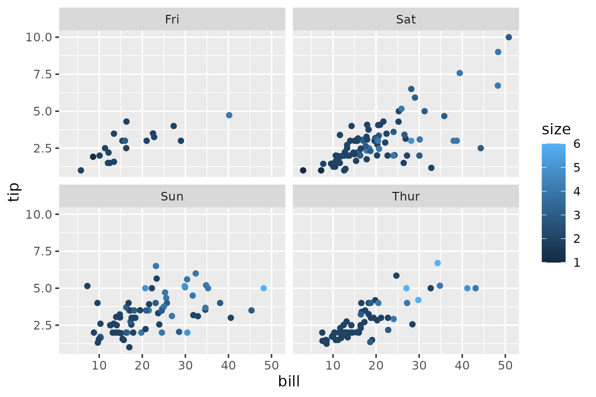{#fig-plot-demo fig-align="center" width="90%"}

Depending on your setup, there are different options available to display images.
I know of four options, each with their own advantages and disadvantages:
(1) as a textual representation,
(2) as an inline image,
(3) using an image viewer, and
(4) using a browser.
Let's go through them quickly.

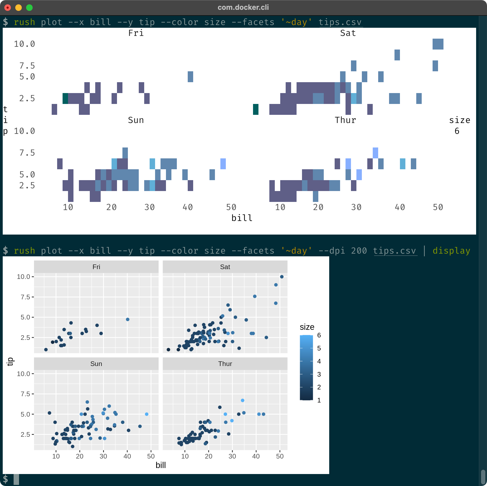{#fig-screenshot-display-ansi-and-inline fig-align="center"}

Option 1 is to display the image inside the terminal as shown at the top of @fig-screenshot-display-ansi-and-inline.
This output is generated by `rush` when the standard output is not redirected to a file.
It's based on ASCII characters and ANSI escape sequences, so it's available in every terminal.
Depending on how you're reading this book, the output you get when you run this code might or might not match the screenshot in @fig-screenshot-display-ansi-and-inline.

```{term}
#| label: plot_demo_ansi
#| style.trailing-spaces: true
#| remove: [-2, -1]
rush plot --x bill --y tip --color size --facets '~day' tips.csv
```

If you only see ASCII characters, that means the medium on which you're reading this book doesn't support the ANSI escape sequences responsible for the colors.
Fortunately, if you run the above command yourself, it will look just like the screenshot.

Option 2, as seen at the bottom of @fig-screenshot-display-ansi-and-inline, also displays images inside the terminal.
This is the iTerm2 terminal, which is only available for macOS and uses the [Inline Images Protocol](https://iterm2.com/documentation-images.html) through a small script (which I have named `display`).
This script is not included with the Docker image, but you can easily install it:

```{term}
curl -s "https://iterm2.com/utilities/imgcat" > display && chmod u+x display #! enter: false
ctrl-c #! literal: false
```

If you're not using iTerm2 on macOS, there might be other options available to display images inline.
Please consult your favorite search engine. 

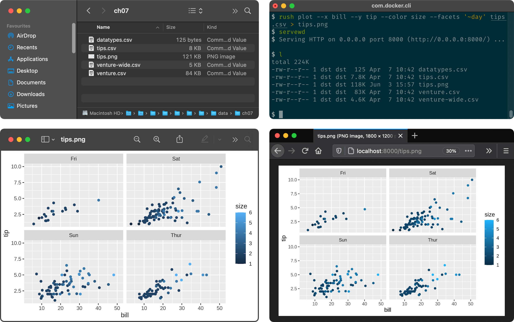{#fig-screenshot-display-preview-and-browser fig-align="center"}

Option 3 is to manually open the image (*tips.csv* in this example) in an image viewer.
@fig-screenshot-display-preview-and-browser shows, on the left, the file explorer (Finder) and image viewer (Preview) on macOS.
When you're working locally, this option always works.
When you're working inside a Docker container, you can only access the generated image from your OS when you've mapped a local directory using the `-v` option.
See [Chapter 2](chapter-2-getting-started.qmd) for instructions on how to do this.
An advantage of this option is that most image viewers automatically update the display when the image has changed, which allows for quick iterations as you fine-tune your visualization.

Option 4 is to open the image in a browser.
The right side of @fig-screenshot-display-preview-and-browser is a screenshot of Firefox showing *http://localhost:8000/tips.png*.
Any browser will do, but you need two other prerequisites for this option to work.
First, you need to have made a port (port 8000 in this example) accessible on the Docker container using the `-p` option.
(Again, see [Chapter 2](chapter-2-getting-started.qmd) for instructions on how to do this.)
Second, you need to start a webserver. 
For this, the Docker container has a small tool called `servewd` [@servewd], which serves the current working directory using Python:

```{term}
bat $(which servewd)
```

You only need to run `servewd` once from a directory (for example, */data/*) and it will happily run in the background.
Once you've plotted something, you can visit *localhost:8000* in your browser and access the contents of that directory and all of its subdirectories. 
The default port is 8000, but you can change this by specifying it as an argument to `servewd`:

```{term}
servewd 9999 #! enter: false
ctrl-c #! literal: false
```

Just make sure that this port is accessible.
Because `servewd` runs in the background, you need to stop it as follows:

```{term}
pkill -f http.server
```

Option 4 can also work on a remote machine.

Now that we've covered four options to display images, let's move on to actually creating some.

### Plotting in a Rush

When it comes to creating data visualizations, there's a plethora of options.
Personally, I’m a staunch proponent of `ggplot2`, which is a visualization package for R.
The underlying grammar of graphics is accompanied by a consistent API that allows you to quickly and iteratively create different types of beautiful data visualizations while rarely having to consult the documentation.
A welcoming set of properties when exploring data.

We're not really in a rush, but we also don't want to fiddle too much about any single visualization.
Moreover, we'd like to stay at the command line as much as possible.
Luckily, we still have `rush`, which allows us to `ggplot2` from the command line. 
The data visualization from @fig-plot-demo could have been created as follows:

```{term}
#| label: rush_ggplot2
rush run --library ggplot2 'ggplot(df, aes(x = bill, y = tip, color = size)) + geom_point() + facet_wrap(~day)' tips.csv > tips.png #! enter: false
ctrl-c #! literal: false
```

However, as you may have noticed, I have used a very different command to create *tips.png*:

```{term}
#| label: rush_plot_again
rush plot --x bill --y tip --color size --facets '~day' tips.csv > tips.png #! enter: false
ctrl-c #! literal: false
```

While the syntax of `ggplot2` is relatively concise, especially considering the flexibility it offers, there's a shortcut to create basic plots quickly.
This shortcut is available through the `plot` subcommand of `rush`.
This allows you to create beautiful basic plots without needing to learn R and the grammar of graphics.

Under the hood, `rush plot` uses the function `qplot` from the `ggplot2` package.
Here's the first part of its documentation:

```{term}
R -q -e '?ggplot2::qplot' | trim 14
```

I agree with this advice; once you're done reading this book, it'll be worthwhile to learn `ggplot2`, especially if you want to upgrade any exploratory data visualizations into ones that are suitable for communication.
For now, while we're at the command line, let's take that shortcut.

As @fig-screenshot-display-ansi-and-inline already showed, `rush plot` can create both graphical visualizations (consisting of pixels) and textual visualizations (consisting of ASCII characters and ANSI escape sequences) with the same syntax.
When `rush` detects that its output is piped to another command (such as `display` or redirected to a file such as *tips.png* it will produce a graphical visualization; otherwise it will produce a textual visualization.

Let's take a moment to read through the plotting and saving options of `rush plot`:

```{term}
rush plot --help
```

The most important options are the plotting options that take a *`<name>`* as an argument.
For example, the `--x` option allows you to specify which column should be used to determine where *things* should be placed along the x axis.
The same holds for the `--y` option. 
The `--color` and `--fill` options are used to specify which column you want to use for coloring.
You can probably guess what the `--size` and `--alpha` options are about.
Other common options are explained throughout the sections as I create various visualizations.
Note that for each visualization, I first show its textual representation (ASCII and ANSI characters) and then its visual representation (pixels).

### Creating Bar Charts

Bar charts are especially useful for displaying the value counts of a categorical feature. 
Here's a textual visualization of the *time* feature in the tips dataset:

```{term}
#| label: plot_bar_ansi
#| style.trailing-spaces: true
#| remove: [-2, -1]
rush plot --x time tips.csv
```

@fig-plot-bar-image shows the graphical visualization, which is created by `rush plot` when the output is redirected to a file.

```{term}
#| label: plot_bar_png
rush plot --x time tips.csv > plot-bar.png
display plot-bar.png
```
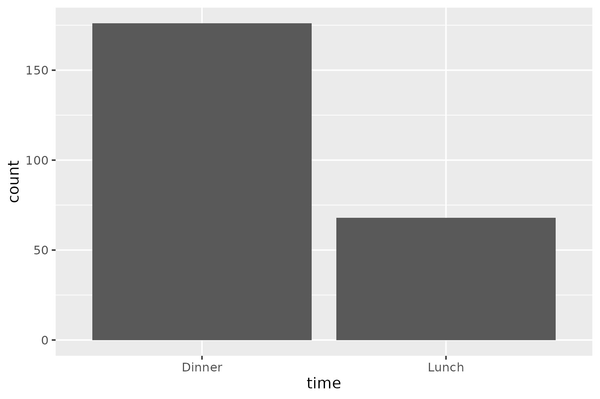{#fig-plot-bar-image fig-align="center" width="90%"}

The conclusion we can draw from this bar chart is straightforward: there are more than twice as many data points for dinner than lunch.

### Creating Histograms

The counts of a continuous variable can be visualized with a histogram.
Here, I have used the *time* feature to set the fill color.
As a result, `rush plot` conveniently creates a stacked histogram.

```{term}
#| label: plot_histogram_ansi
#| style.trailing-spaces: true
#| remove: [-2, -1]
rush plot --x tip --fill time tips.csv
```

@fig-plot-histogram-image shows the graphical visualization. 

::: {.callout-tip}
Allow me to demonstrate two syntax shortcuts that you may find useful.
The two exclamation marks (`!!`) get replaced with the previous command.
The exclamation mark and dollar sign (`!$`) get replaced by the last part of the previous command, which is the filename *plot-histogram.png*.
As you can see, the updated commands are first printed by the Z shell so you know exactly what it executes.
These two shortcuts can save a lot of typing, but they're not easy to remember.
:::

```{term}
#| label: plot_histogram_png
!! > plot-histogram.png
display !$
```
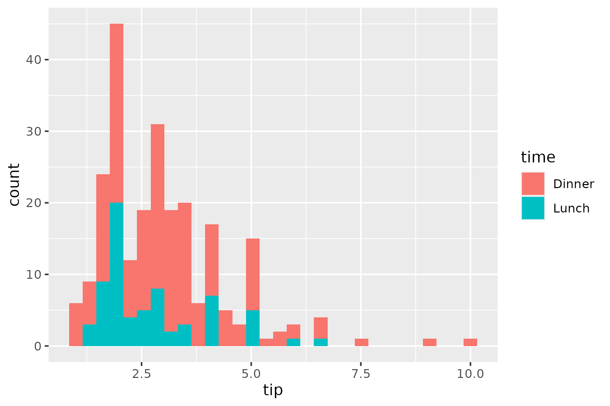{#fig-plot-histogram-image fig-align="center" width="90%"}

This histogram reveals that most tips are around 2,5 USD.
Because the two groups dinner and lunch groups are stacked on top of each other and show absolute counts, it's difficult to compare them.
Perhaps a density plot can help with this.

### Creating Density Plots

A density plot is useful for visualizing the distribution of a continuous variable. 
`rush plot` uses heuristics to determine the appropriate geometry, but you can override this with the `geom` option:

```{term}
#| label: plot_density_ansi
#| style.trailing-spaces: true
#| remove: [-2, -1]
rush plot --x tip --fill time --geom density tips.csv
```

In this case, the textual representation really shows its limitations when compared to the visual representation in @fig-plot-density-image.

```{term}
#| label: plot_density_png
rush plot --x tip --fill time --geom density tips.csv > plot-density.png
display plot-density.png
```
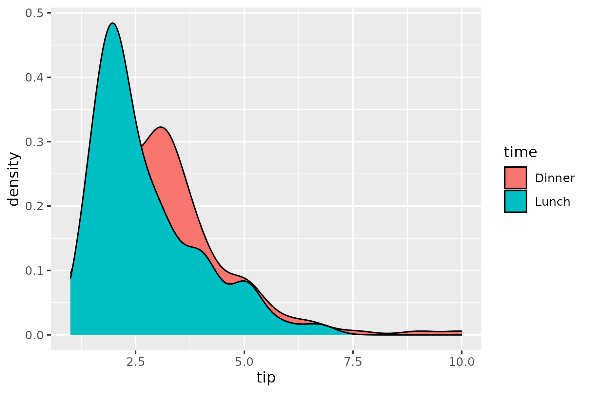{#fig-plot-density-image fig-align="center" width="90%"}

### Happy Little Accidents

You've already seen three types of visualizations.
In `ggplot2`, these correspond to the functions `geom_bar`, `geom_histogram`, and `geom_density`.
*geom* is short for geometry and dictates what is actually being plotted.
This [cheat sheet for `ggplot2`](https://ggplot2.tidyverse.org/) provides a good overview of the available geometry types. 
Which geometry types you can use depend on the columns (and their types) you specify.
Not every combination makes sense.
Take this line plot for example.

```{term}
#| label: plot_accident_ansi
#| style.trailing-spaces: true
#| remove: [-2, -1]
rush plot --x tip --y bill --color size --size day --geom path tips.csv
```

This happy little accident becomes clearer in the visual representation in @fig-plot-accident-image.

```{term}
#| label: plot_accident_png
rush plot --x tip --y bill --color size --size day --geom path tips.csv > plot-accident.png
display plot-accident.png
```
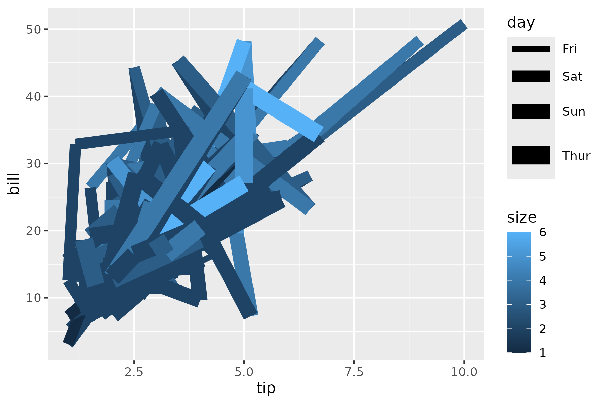{#fig-plot-accident-image fig-align="center" width="90%"}

The rows in *tips.csv* are independent observations, whereas drawing a line between the data points assumes that they are connected.
It's better to visualize the relationship between the *tip* and the *bill* with a scatter plot.

### Creating Scatter Plots

A scatter plot, where the geometry is a point, happens to be the default when specifying two continuous features:

```{term}
#| label: plot_scatter_ansi
#| style.trailing-spaces: true
#| remove: [-2, -1]
rush plot --x bill --y tip --color time tips.csv
```

Note that the color of each point is specified with the `--color` option (and not with the `--fill` option).
See @fig-plot-scatter-image for the visual representation.

```{term}
#| label: plot_scatter_png
rush plot --x bill --y tip --color time tips.csv > plot-scatter.png
display plot-scatter.png
```
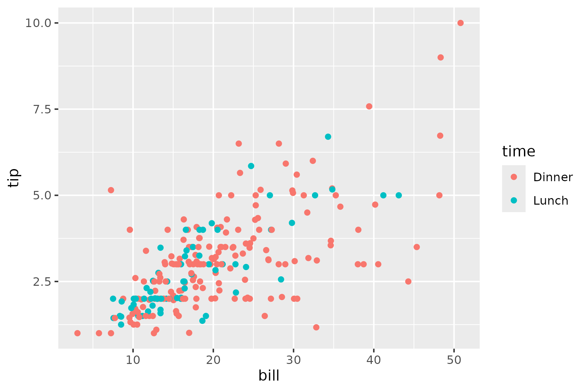{#fig-plot-scatter-image fig-align="center" width="90%"}

From this scatter plot we may conclude that there's a relationship between the amount of the bill and the tip. 
Perhaps we it's useful to examine this data from a higher level by creating trend lines.

### Creating Trend Lines

If you override the default geometry with *`smooth`*, you can visualize trend lines.
These are useful for seeing the bigger picture.

```{term}
#| label: plot_trend_ansi
#| style.trailing-spaces: true
#| remove: [-2, -1]
rush plot --x bill --y tip --color time --geom smooth tips.csv
```

`rush plot` cannot handle transparency, so a visual representation (see @fig-plot-trend-image is much better in this case.

```{term}
#| label: plot_trend_png
rush plot --x bill --y tip --color time --geom smooth tips.csv > plot-trend.png
display plot-trend.png
```
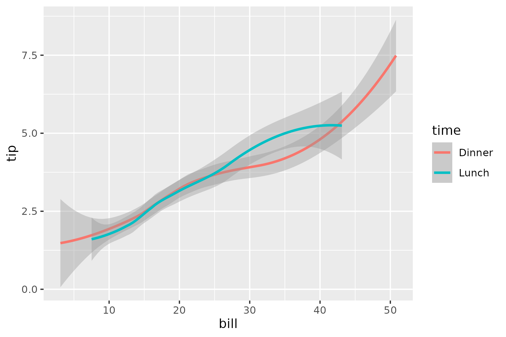{#fig-plot-trend-image fig-align="center" width="90%"}

If you like to visualize the original points along with the trend lines, you need to resort to writing `ggplot2` code with `rush run` (see @fig-plot-trend-points-image).

```{term}
#| label: plot_trend_points_png
rush run --library ggplot2 'ggplot(df, aes(x = bill, y = tip, color = time)) + geom_point() + geom_smooth()' tips.csv > plot-trend-points.png
display plot-trend-points.png
```
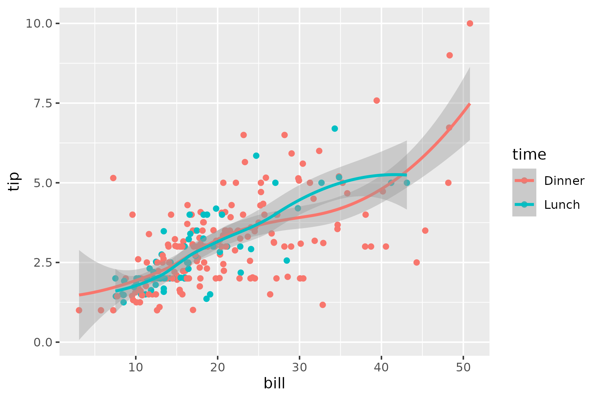{#fig-plot-trend-points-image fig-align="center" width="90%"}

### Creating Box Plots

A box plot visualizes, for one or more features, a five-number summary: the minimum, the maximum, the sample median, and the first and third quartiles. 
In this case we need to convert the *size* feature to a categorical one using the `factor()` function, otherwise all values of the *bill* feature will be lumped together. 

```{term}
#| label: plot_boxplot_ansi
#| style.trailing-spaces: true
#| remove: [-2, -1]
rush plot --x 'factor(size)' --y bill --geom boxplot tips.csv
```

While the textual representation is not too bad, the visual one is much clearer (see @fig-plot-boxplot-image).

```{term}
#| label: plot_boxplot_png
rush plot --x 'factor(size)' --y bill --geom boxplot tips.csv > plot-boxplot.png
display plot-boxplot.png
```
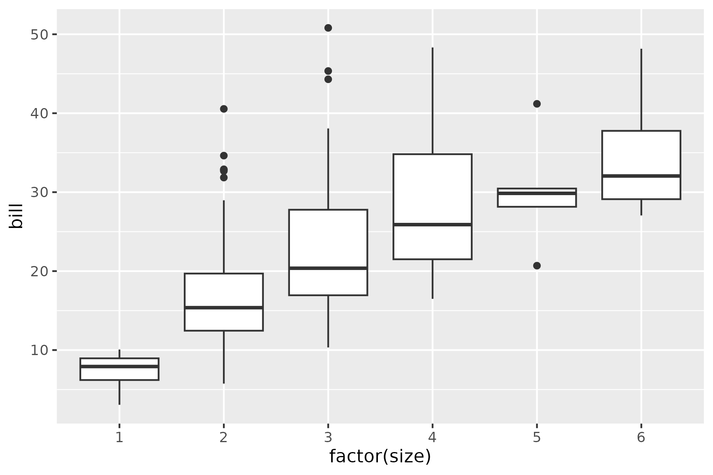{#fig-plot-boxplot-image fig-align="center" width="90%"}

Unsurprisingly, this box plot shows that, on average, a larger party size leads to a higher bill.

### Adding Labels

The default labels are based on column names (or specification).
In the previous image, the label *`factor(size)`* should be improved.
Using the `--xlab` and `--ylab` options you can override the labels of the x and y axes.
A title can be added with the `--title` option.
Here's a violin plot (which is a mashup of a box plot and a density plot) demonstrating this (see also @fig-plot-labels-image.

```{term}
#| label: plot_labels_ansi
#| style.trailing-spaces: true
#| remove: [-2, -1]
rush plot --x 'factor(size)' --y bill --geom violin --title 'Distribution of bill amount per party size' --xlab 'Party size' --ylab 'Bill (USD)' tips.csv
```

```{term}
#| label: plot_labels_png
rush plot --x 'factor(size)' --y bill --geom violin --title 'Distribution of bill amount per party size' --xlab 'Party size' --ylab 'Bill (USD)' tips.csv > plot-labels.png
display plot-labels.png
```
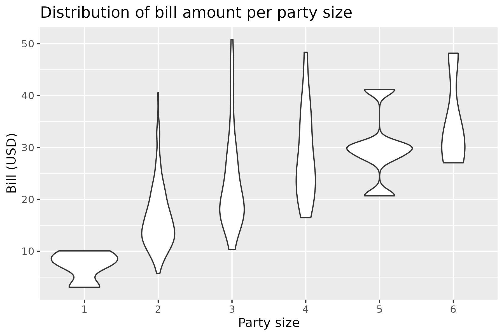{#fig-plot-labels-image fig-align="center" width="90%"}

Annotating your visualization with proper labels and a title is especially useful if you want to share it with others (or your future self) so that it's easier to understand what's being shown.

### Going Beyond Basic Plots

Although `rush plot` is suitable for creating basic plots when you're exploring data, it certainly has its limitations. 
Sometimes you need more flexibility and sophisticated options such as multiple geometries, coordinate transformations, and theming.
In that case it might be worthwhile to learn more about the underlying package from which `rush plot` draws its capabilities, namely the `ggplot2` package for R. 
When you're more into Python than R, there's the [`plotnine` package](https://plotnine.readthedocs.io), which is reimplementation of `ggplot2` for Python.

## Summary {#summary-6}

In this chapter we've looked at various ways to explore your data.
Both textual and graphical data visualizations have their pros and cons.
The graphical ones are obviously of much higher quality, but can be tricky to view at the command line.
This is where textual visualizations come in handy.
At least `rush` has, thanks to `R` and `ggplot2`, a consistent syntax for creating both types.

The next chapter is, once again, an intermezzo chapter in which I discuss how you can speed up your commands and pipelines.
Feel free to read that chapter later if you can't wait to start modeling your data in [Chapter 9](chapter-9-modeling-data.qmd).

## For Further Exploration {#for-further-exploration-6}

- A proper `ggplot2` tutorial is unfortunately beyond the scope of this book. If you want to get better at visualizing your data I strongly recommend that you invest some time in understanding the power and beauty of the grammar of graphics. Chapters 3 and 28 of the book [*R for Data Science*](https://r4ds.had.co.nz/) by Hadley Wickham and Garrett Grolemund are an excellent resource.
- Speaking of Chapters 3 and 28, I [translated those to Python using Plotnine and Pandas](https://datascienceworkshops.com/blog/plotnine-grammar-of-graphics-for-python/) in case you're more into Python than R.
